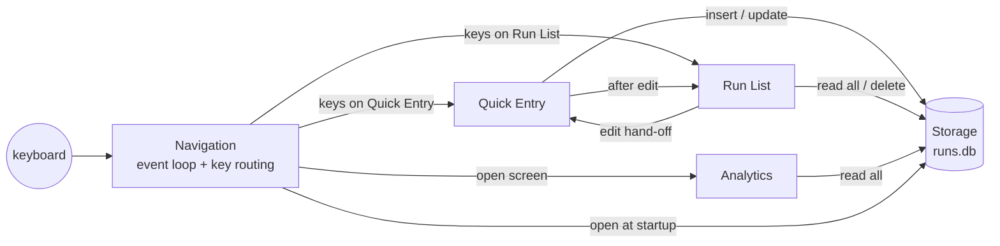

# High-Level Design: Run Logger

## Problem

A daily running habit — at least one mile every day — is easy to lose track of. Fitness apps bury the one number that matters (*did I run a mile today, and how long is the streak?*) under pace, routes, social feeds and accounts, and logging a run means unlocking a phone and navigating screens. A habit that depends on daily consistency needs logging that is nearly frictionless and a streak view that is always honest.

## Approach

Run Logger is a single-user terminal app. Launching it lands on a form with today's date and the current time already filled in; the user types a distance and presses Enter. Every figure the app shows — current and longest streak, progress toward 365 goal-met days this year, rolling volume statistics, a 14-day chart, monthly mileage — is recomputed from the full run history each time it is shown, so there is no derived state to drift.

The daily goal is one rule applied everywhere: a local calendar date is goal-met when the runs on it total at least 1.0 mile.

## Target Users

One person tracking their own daily-mile habit from a terminal they already have open. They want to log a run in seconds, occasionally fix or delete a mistaken entry, backfill a missed day, and glance at their streak. They are comfortable with keyboard-only interfaces.

## Goals

- Logging today's run takes one number and Enter from launch.
- The streak and year-goal figures always match what a careful hand count of the history would give.
- A storage or data problem never costs the user the rest of the app: errors are shown, and the app keeps running.
- The history is durable across launches and lives in one local file.

## Non-Goals

- Multiple users, accounts, or sync between machines.
- Import from GPS watches, phones or fitness services.
- Pace, heart rate, routes, or any per-run data beyond date, start time, distance and note.
- Units other than miles.
- A configurable daily goal; the goal is one mile.
- Logging runs that have not happened yet (a date and time after now).

## Tenets

Ordered: when two conflict, the higher one wins.

- **Fast logging over richer data.** When a feature would add a field or a step to logging a run, keep logging at "distance and Enter" and put the extra elsewhere or leave it out.
- **Generous with the goal over strict.** When a goal or streak rule is ambiguous, resolve it in the runner's favor.
- **Recompute over store.** Never persist a figure that can be derived from the run history; compute it when it is shown.

## System Design

Five components, each with its own design doc under `docs/intent/`:

| Component | Prefix | Responsibility |
|---|---|---|
| [Storage](intent/storage/storage-design.md) | `STORE` | One SQLite file in the per-user data directory; schema, stored formats, insert/read/update/delete. |
| [Quick Entry](intent/quick-entry/quick-entry-design.md) | `QE` | The logging form: prefilled fields, parsing and run rules, insert and edit-save. |
| [Run List](intent/run-list/run-list-design.md) | `RL` | Browse the full history, select a run, hand it to Quick Entry to edit, or delete it. |
| [Analytics](intent/analytics/analytics-design.md) | `AN` | The daily-goal rule, streaks, year goal, statistics, and the Analytics screen. |
| [Navigation](intent/navigation/navigation-design.md) | `NAV` | Startup and shutdown, terminal ownership, event loop, key routing, header/footer, Help. |

All state lives in one `App` value owned by the event loop; each screen has its own state struct within it. Screens never call each other's code directly except through the hand-offs shown: Run List passes a run to Quick Entry for editing, and Quick Entry returns to Run List after an edit is saved.

**Cross-cutting conventions**

- **Dates are local calendar days.** Runs carry a naive local date and start time; "today" means the user's local date.
- **Full-history reads.** Run List and Analytics reload the entire history each time they open. At one user and roughly one run a day, the history stays small for years.
- **Errors stay on screen.** A failing storage operation is shown on the screen that triggered it; the app ends only on a quit command or a terminal failure.
- **Tests** are inline `#[cfg(test)]` modules beside the code they test. Behavior that touches storage is tested against an in-memory SQLite database initialized with the real schema; behavior that depends on "today" takes the date as a parameter. Each test that directly exercises a spec cites it with `// @spec`.
- **Spec IDs** are `{PREFIX}-{NNN}`; each component's specs live beside its design doc as `{component}-specs.md`, and code cites them with `// @spec` comments at the entry point of each behavior.

## Key Design Decisions

| Decision | Chosen | Alternatives Considered | Rationale |
|---|---|---|---|
| Interface | Terminal UI (`ratatui` + `crossterm`) | Mobile app; web app; plain CLI commands | Fastest path from an open terminal to a logged run, with a persistent dashboard that a one-shot CLI lacks. |
| Persistence | Embedded SQLite file in the per-user data directory | Flat JSON/CSV; hosted database | Durable, constraint-checked, zero setup, and private to the machine. |
| Derived figures | Recompute from the full history on every view | Store streaks and totals; incremental updates | Nothing derived can drift from the runs it summarizes; the data is small. |
| Goal unit | Sum of all runs on a local calendar day ≥ 1.0 mile | Single run must reach 1 mile | Several short runs in one day honor the habit just as well. |
| Generous goal accounting | An unfinished today never breaks the streak; totals are compared with a rounding tolerance | Strict accounting | The streak should reflect the habit, not the time of day or floating-point artifacts. |
| Navigation model | Esc prefix for commands from the text form; single keys elsewhere | Function keys; Ctrl shortcuts | Works on every terminal and keeps every printable character available for typing. |
| One editing path | Edits reuse the Quick Entry form | Inline editing in Run List | One set of parsing and validation rules for new and edited runs. |

## Success Metrics

- From launch, a run is logged with a distance and one Enter, with no other keys.
- The app never exits because of a storage error; a bad row or failed write is visible on screen.
- Current streak, longest streak and year-goal count agree with a hand count over any sample history, including days with several runs and days whose runs sum to exactly 1.0 mile.
- Every key hint shown on screen does what it says.

## References

- Component design docs and specs: `docs/intent/`
- Arrow index and per-component status: `docs/arrows/index.yaml`, `docs/arrows/*.md`
- User-facing documentation: `README.md`
- Libraries: `ratatui` 0.30, `crossterm` 0.29, `rusqlite` 0.40 (bundled SQLite), `chrono` 0.4, `dirs` 7, `anyhow` 1
